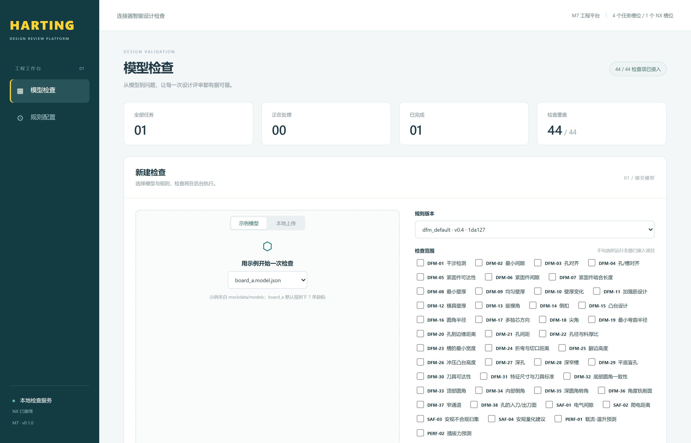
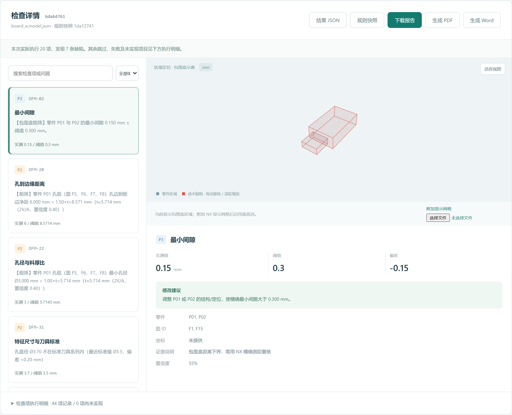
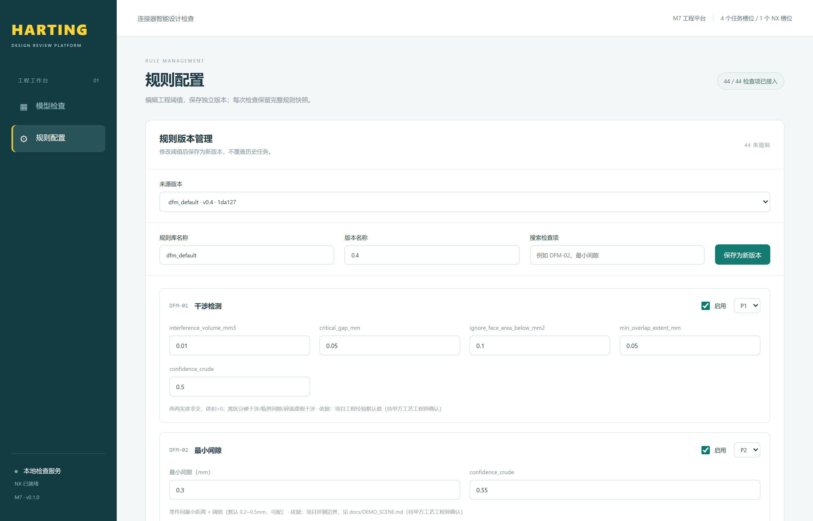
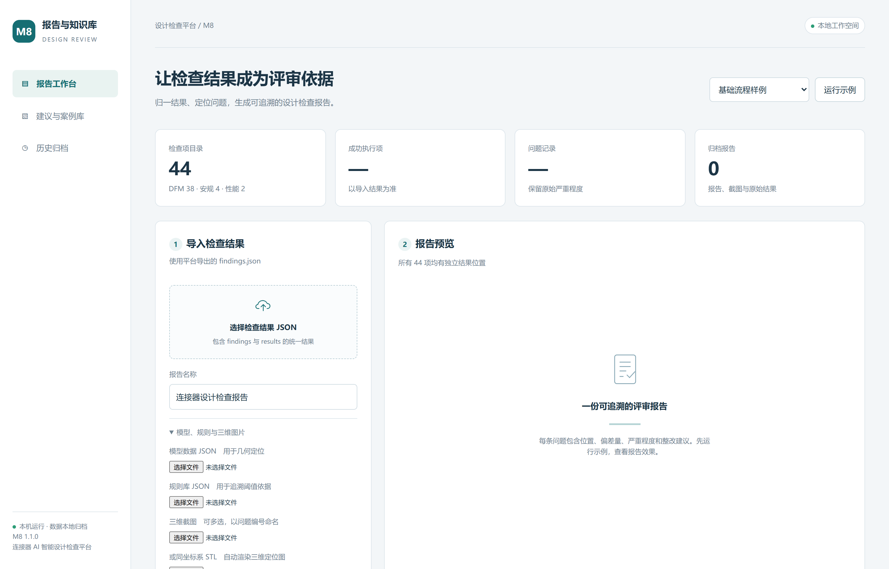
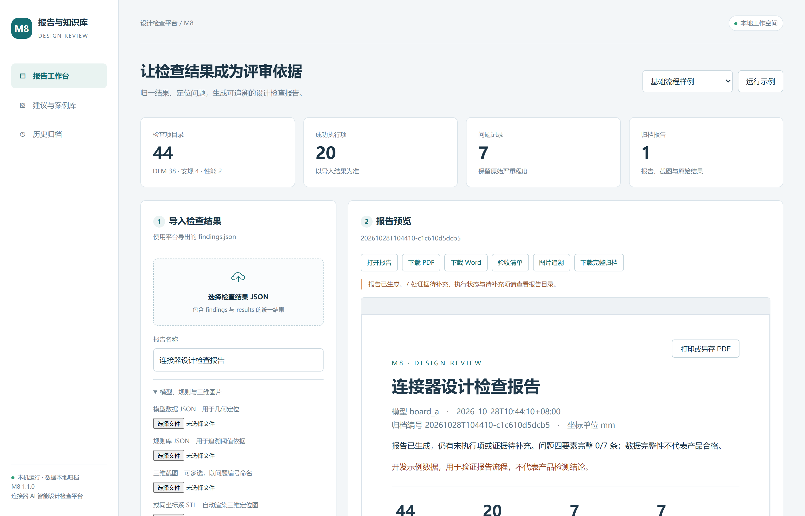

# 运行说明：用可视化界面走完整个检查流程

适用版本：本目录这份合并版（8 个模块、44 / 44 检查项）。
目标：不写代码、不碰命令行，用浏览器完成 **选模型 → 开始检查 → 看缺陷 → 下载报告**，
外加 **改规则阈值再跑一遍** 和 **单独用报告台** 两条支线。

> 截图都是本机实际运行截的，界面上的数字就是这台机器跑出来的真实结果。

> **先注意一件事：不要在压缩包里直接双击 `.cmd`。**
> 请先解压整个 zip，或者直接用本机已经解压好的 `E:\Desktop\harting_drp_merged\harting_drp_merged` 文件夹，
> 在文件夹里双击 `启动平台.cmd`。压缩包里双击时 Windows 只会把 cmd 一个文件解到临时目录，
> 工程、`.python` 和 `.venv` 都不在，脚本就找不到 Python。

## 一句话版本

在**解压后的文件夹**里双击 `启动平台.cmd` → 浏览器自动打开平台地址 → 示例模型选 `board_a.model.json` → 点 **开始检查** → 点任务右侧 **查看 →** → 点 **生成 PDF**。下面把每一步展开。

---

## 一、先看一眼整个流程

```
双击 启动平台.cmd
        │
        ▼
浏览器自动打开平台地址（8000 / 8010 / …，以窗口打印为准）
        │
        ├─ 左侧「模型检查」
        │     ① 选示例模型（或本地上传 .json / .prt）
        │     ② 选规则版本（默认 dfm_default v0.4）
        │     ③ 点「开始检查」
        │     ④ 任务记录里看状态：排队中 → 检查中 → 已完成
        │     ⑤ 检查详情：缺陷列表 + 3D 定位 + 实测/阈值/偏差/建议
        │     ⑥ 下载报告 / 结果 JSON / 规则快照
        │
        └─ 左侧「规则配置」
              改阈值 → 保存为新版本 → 回模型检查用新版本再跑
```

---

## 二、一次性准备（只做一次）

### 1. Python（本包自带，可跳过）

本交付包把 **Python 3.12.14** 放在 `.python\`，把 FastAPI / uvicorn / reportlab 等依赖放在 `.venv\`，
双击 `启动平台.cmd` 时优先用它们，**这台机器不用另装 Python，也不用联网**。

自己敲命令时把 `python` 换成 `.venv\Scripts\python.exe` 即可：

```powershell
.\.venv\Scripts\python.exe --version
```

唯一要留意的：整个文件夹搬到别的机器或改了名之后，`.venv` 里记的还是旧路径。
启动脚本会自己发现并改掉（窗口里出现 `Repairing .venv for this machine` 就是它在修），修完照常启动。

### 2. 装可选依赖（平台 界面 + 报告要用）

> **本目录已经带了 `.venv`，且依赖已装好，这一步可以跳过。**
> 启动脚本现在**不会联网装包**（这台机器连不上 PyPI 也能用），所以 `.venv` 别删、别单独拷走。
> 真需要重装时手动执行下面的命令（要能访问 PyPI）。

在仓库根目录（本文件所在目录）打开命令行：

```powershell
.\.venv\Scripts\python.exe -m pip install -r requirements.txt
```

这一步装的是 FastAPI/uvicorn（Web 界面）和 reportlab/pypdf 等（Word/PDF 报告）。
**核心检查器本身零第三方依赖**，不装也能用命令行检查，但界面和 PDF 报告需要它。

> 内网装不上时，可让能上网的机器先 `pip download -r requirements.txt -d wheels`，
> 再把 `wheels` 目录拷过来 `.\.venv\Scripts\python.exe -m pip install --no-index --find-links wheels -r requirements.txt`。

### 3. NX（可选）

- 装了几何解析用的 NX（本机是 NX 2606），界面左下角会显示 **"NX 已就绪"**，此时可以上传 `.prt`；
- 没装 NX 也能演示：用 `mockdata/models/*.model.json`（已解析好的模型），日志区会显示 "未连接 · 可使用 JSON 模型"。

### 4. 端口

- 平台 界面：默认从 `8000` 开始试，被占用就依次换 `8010 / 8020 / … / 8060`，**以启动窗口里打印的地址为准**。
  这台机器 `8000` 空着，正常就是 `http://127.0.0.1:8000`；装过 C-Lodop 打印服务的机器会落到 `8010`。
- 报告台：`8768`。

---

## 三、启动

### 方式 A：双击（推荐）

双击仓库根目录的 **`启动平台.cmd`**。

它依次做这几件事：

1. 找可用的 Python 3.12（优先本包自带的 `.venv`，路径不对就自动修；再退回 `.python`；最后才找系统 Python）；
2. 挑一个空闲端口（8000 → 8010 → … → 8060，被占用就往后挪）；
3. 设置报告生成器（`NXDRP_REPORT_PROVIDER`），报告页才有 Word / PDF 按钮；
4. 启动平台服务；
5. 等 `/api/health` 正常后**自动打开浏览器**。

窗口里出现这样的内容就说明起来了（端口以窗口打印为准）：

```
  HARTING 设计检查平台   http://127.0.0.1:8000
  接口文档               http://127.0.0.1:8000/docs
  看到下面出现 Uvicorn running on 就是启动成功。
...
INFO:     Uvicorn running on http://127.0.0.1:8000 (Press CTRL+C to quit)
[平台] 浏览器已打开：http://127.0.0.1:8000
```

> - 别关那个命令行窗口，关掉就等于关服务；停止服务按 `Ctrl+C`。
> - 重复双击不会起第二个进程：脚本会发现已经在跑的那份，直接把浏览器指过去。
> - 本包自带 `.venv` + `.python`，不用装 Python、不用联网；
>   文件夹改名或搬到别的机器后，首次双击会自动修 `.venv` 的路径。
> - 想固定端口：`启动平台.cmd 8020`；不想自动开浏览器：先 `set NXDRP_NO_BROWSER=1` 再双击。

### 方式 B：命令行（想改端口 / 看日志时）

```powershell
cd <解压后的目录，例如 harting_drp_merged>
$env:NXDRP_REPORT_PROVIDER = 'nxdrp.checkers.report:generate_report'
.\.venv\Scripts\python.exe -m nxdrp.checkers.platform_web --port 8010
```

没有 `.venv` 时把 `.\.venv\Scripts\python.exe` 换成自己的 `python`（3.12+，并先装好 `requirements.txt`）。
端口按需改，浏览器地址同步改。

### 启动后你会看到



三个地方值得先确认：

| 位置 | 说明 |
|---|---|
| 右上角 `44 / 44 检查项已接入` | 8 个人的模块全部注册成功 |
| 左下角 `NX 已就绪` | 这台机器能解析 .prt；显示"未连接"也不影响 JSON 模型 |
| `规则版本 dfm_default · v0.4 · xxxxxx` | 当前规则快照的唯一 ID，每次检查都会记录它 |

---

## 四、主流程：跑一次检查（照着点）

### 第 1 步：新建检查

在「模型检查」页的 **新建检查** 卡片里：

- **示例模型**（默认）：下拉框选 `board_a.model.json`，下面提示写着"board_a 默认规则下 7 条缺陷"；
- **本地上传**：选自己的 `.model.json`，或单零件 `.prt`（需 NX，解析约 30–60 秒）。

> 示例下拉框里是 `mockdata/models/` 下的 13 个模型，`pressure_port` / `plate_holes` 是真实 NX 导出的数据。

### 第 2 步：规则与检查范围

- **规则版本**：保持默认 `dfm_default · v0.4`；
- **检查范围**：**什么都不勾 = 运行全部 44 项**。只有想单独调试某一项时才勾（例如只勾 DFM-02）。

### 第 3 步：开始检查

点绿色 **开始检查**。下方「任务记录」会多一行：

| 状态 | 含义 |
|---|---|
| 排队中 | 后台任务队列，前一个跑完就轮到 |
| 解析模型 | 只有上传 `.prt` 才有这一步，正在启动 NX |
| 检查中 | 显示当前检查项和 `已处理/总数`，不显示假的百分比 |
| 已完成 / 失败 | 失败会写出具体原因，单任务失败不影响其他任务 |

board_a 用 JSON 模型：约 **1 秒**；plate_holes 用 `.prt`：约 **45–60 秒**（其中 30 多秒是等 NX）。

### 第 4 步：看检查详情

点任务行右侧 **查看 →**，页面下方展开「检查详情」：



- 顶部一句话：**本次实际执行 20 项，发现 7 条缺陷**；
- 左侧缺陷卡片：可按级别（P0/P1/P2/P3）筛选、按检查项或关键词搜索；
- 点任一条：右侧 3D 区域显示包围盒位置，下方给出 **实测值 / 阈值 / 偏差 / 修改建议 / 零件 / 面 ID / 坐标 / 置信度**；
- 右下角 `检查项执行明细 · 44 项记录`：每一项的状态是"已执行 / 已跳过 / 缺少数据 / 未选择"，并写明原因——
  没执行的项不会伪装成"通过"。

> 3D 区域默认按包围盒示意。若上游提供了 face_id 网格，点 **附加显示网格** 选 JSON，就能按 `evidence.face_ids` 精确高亮面。

### 第 5 步：下载

「检查详情」右上角：

| 按钮 | 得到什么 |
|---|---|
| 结果 JSON | 原始 `CheckRun`，可导入 报告 或做评测 |
| 规则快照 | 这次检查用的规则版本（历史任务永远按当时的快照解释） |
| 下载报告 | 独立 HTML 报告，浏览器里可直接打印成 PDF |
| **生成 PDF / 生成 Word** | 调 报告 生成正式报告并下载（启动脚本已配好；没配时这两个按钮不显示） |

---

## 五、支线：改规则再跑一次（演示"改表即改判定"）

1. 左侧点 **规则配置**；
2. 顶部「来源版本」保持 `dfm_default v0.4`，在「搜索检查项」里输入 `DFM-02`；
3. 把 **最小间隙（mm）** 从 `0.3` 改成 `0`；
4. 点 **保存为新版本**（可以先把"版本名称"改成比如 `0.4-clearance-off`）；
5. 回到 **模型检查**，规则版本选刚保存的新版本，再点 **开始检查**。

结果对比：

| 规则版本 | board_a 缺陷数 |
|---|---|
| 默认 v0.4 | 7 条 |
| 最小间隙改成 0 | 6 条（DFM-02 不再报） |
| 原来的任务 | 仍是 7 条 —— 历史任务的规则快照不会被改 |



规则页每个检查项都能改：启用开关、严重度（P0–P3）、数值/文本/布尔/数字列表参数，
每条参数下面都写着依据（哪份标准、哪条经验值、待谁确认）。改完保存只生成新版本，不覆盖历史。

---

## 六、支线：单独用报告台

双击仓库根目录的 **`启动报告台.cmd`**，浏览器打开 **http://127.0.0.1:8768**。



两种用法：

**A. 直接用示例（几秒出报告）**

1. 右上角选 `基础流程样例`；
2. 点 **运行示例**；
3. 几秒后下面出现报告预览和按钮。



统计卡会显示：检查项目录 44、成功执行 20、问题记录 7、归档报告 1。
按钮含义：

| 按钮 | 用途 |
|---|---|
| 打开报告 | 浏览器打开完整 HTML 报告（44 项都有独立位置） |
| 下载 PDF / 下载 Word | 正式报告文件（PDF 内嵌中文字体） |
| 验收清单 | `acceptance.json`：44 项执行状态与四要素完整性 |
| 图片追溯 | 每张定位图的来源与哈希 |
| 下载完整归档 | 报告 + 原始结果 + 模型 + 规则 + 定位图 + 清单的 ZIP |

**B. 导入平台真实结果**

1. 在 平台「检查详情」下载 **结果 JSON**；
2. 报告台上传「选择检查结果 JSON」；
3. （可选）再上传同一模型的几何 JSON、规则 JSON、截图或 STL，定位图会更准；
4. 生成后同样能下载 PDF/Word/归档。

> 左侧「建议与案例库」「历史归档」分别用于查 44 项整改模板、检索历史报告。

---

## 七、常见问题

**Q0：双击后提示 `Python 3.12+ not found`，或窗口一闪而过**
本包自带 `.python`（Python 3.12.14），正常情况下不会出现这个提示。真出现了，先确认这两个目录还在：
`.python\python.exe`、`.venv\Lib\site-packages`——只把 `.cmd` 一个文件拷出来是跑不了的。
其次确认是在**解压后的文件夹**里双击，而不是在压缩包里：压缩包里 Windows 只把 cmd 解到临时目录，
工程和运行时都不在。本机直接用 `E:\Desktop\harting_drp_merged\harting_drp_merged`。

**Q1：提示端口被占用 / 起不来**
启动脚本会自己避开被占用的端口（8000 → 8010 → … → 8060），**以窗口打印的地址为准**。
想手动指定：`启动平台.cmd 8020` 或命令行 `--port 8020`。
如果所有端口都失败，多半是上次的服务没关干净——同一个数据目录有进程锁，第二次启动会被拒绝（见 Q5）。

**Q2：浏览器打开是空白或 `{"message":"请先构建前端..."}`**
说明 `frontend/dist/` 缺失。本包已经带了构建产物；若被删掉，需要：
`cd nxdrp/checkers/platform_web/frontend && npm ci && npm run build`（要 Node.js 20+）。

**Q3：点「生成 PDF」报"尚未配置 报告生成器"**
没用启动脚本，或环境变量丢了。启动前设置：
`$env:NXDRP_REPORT_PROVIDER = 'nxdrp.checkers.report:generate_report'`。

**Q4：上传 `.prt` 一直停在「解析模型」**
正常要 30–60 秒（首次启动 NX 更久）。超过 3 分钟：确认左下角是"NX 已就绪"、NX 没有被别的窗口占用；
也可以先用 `mockdata/models/*.model.json` 演示。

**Q5：再启动一次提示"同一数据目录已有 平台 服务"**
之前那个进程还在。关掉旧窗口（`Ctrl+C`），或在任务管理器结束对应 `python.exe`；
也可以换数据目录：`--data-dir D:\tmp\m7data`。

**Q6：为什么同一模型两次结果条数不一样？**
多半是规则版本不同（看「检查详情」里的"规则快照"编号）。规则改了不会回溯历史任务。

**Q7：检查显示"已完成"，但很多项是"已跳过/缺少数据"？**
这是设计如此：数据不足时明确跳过并写明缺什么，不产出假结果。
"已完成"只代表管线跑完，不代表 44 项都通过——详情页和执行明细分开显示。

---

## 八、数据放在哪、怎么清理

| 内容 | 位置 |
|---|---|
| 任务、上传的模型、规则快照、结果 | `nxdrp/checkers/platform_web/runtime/`（SQLite + 文件） |
| 报告归档 | `report_archives/`（默认在仓库根目录） |

- 想清空演示数据：停服务后删掉 `runtime/` 目录即可；
- 想保留：整个 `runtime/` 拷走就是完整现场；
- 这两个目录都已写进 `.gitignore`，不会被误提交。

---

## 九、3 分钟演示路线（照着念）

1. 双击 `启动平台.cmd`，浏览器会自己打开平台（本机是 http://127.0.0.1:8000，以窗口为准）—— 指一下右上角 **44 / 44 检查项已接入**；
2. 新建检查：示例模型 `board_a.model.json`，规则 v0.4，不勾检查项 —— 点 **开始检查**；
3. 等约 1 秒，任务状态变 **已完成**，点 **查看 →** —— 读那句"本次实际执行 20 项，发现 7 条缺陷"；
4. 点一条 **P1/P2** 缺陷 —— 讲四要素：在哪（3D + 面 ID）、差多少（实测/阈值/偏差）、多严重（严重度）、怎么改（建议）；
5. 展开 **检查项执行明细** —— 强调"没执行的项目不会显示为通过"；
6. 点 **生成 PDF** —— 当场下载一份 Word/PDF 报告；或点 **下载报告** 看 HTML；
7. 进 **规则配置**，把 DFM-02 最小间隙改成 0，保存为新版本；回模型检查再跑一次 —— 变成 6 条，老任务仍 7 条；
8. 收尾：双击 `启动报告台.cmd`（8768），点 **运行示例**，展示 44 项报告、验收清单和图片追溯。
